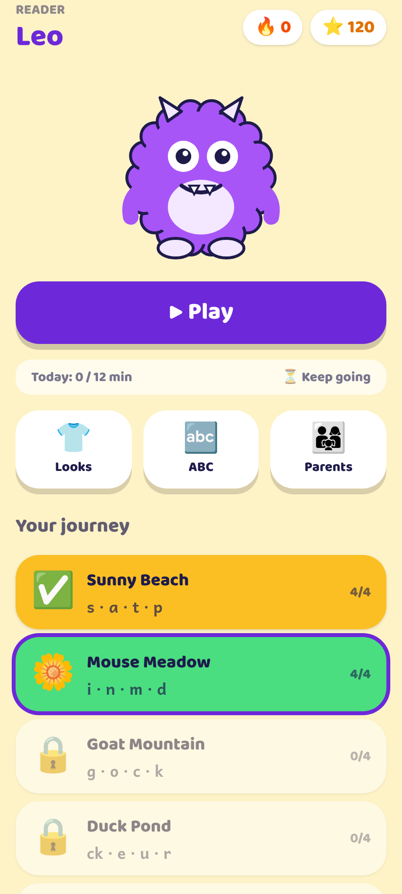
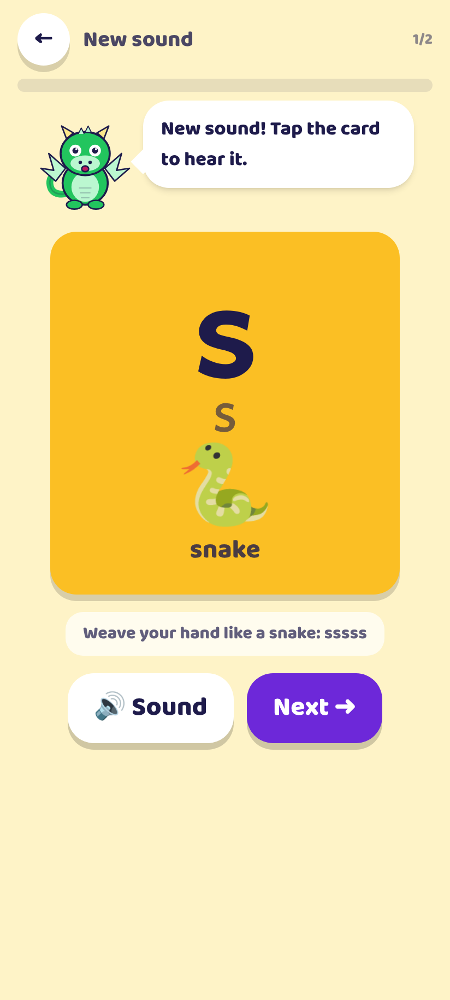
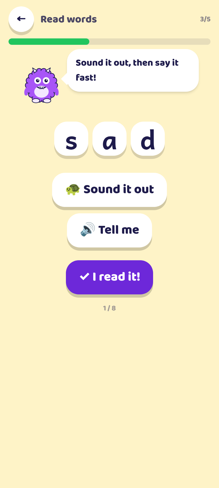
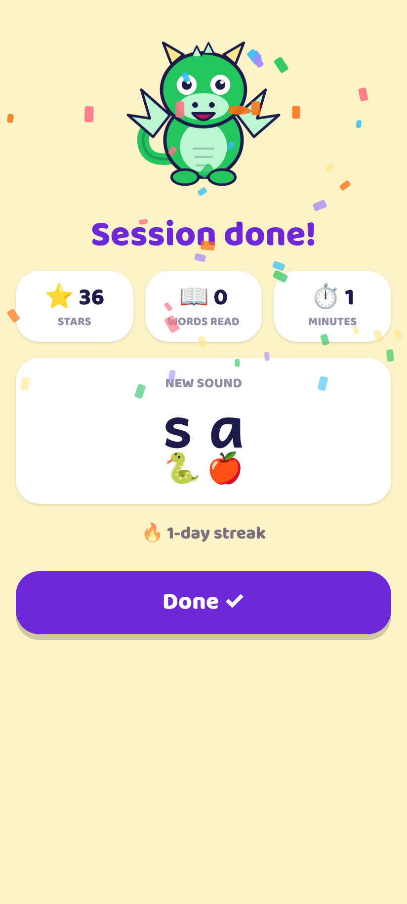
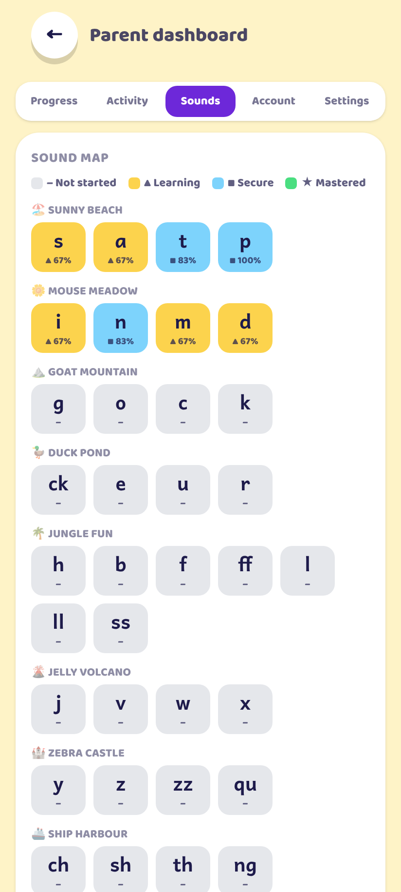

# Reader Quest

A phonics adventure that teaches a child to read. Built for an 8-year-old late starter who knows part of the alphabet: it runs as a web app (PWA) in any modern browser and as an Android app via Capacitor, speaks every sound, word and sentence, rewards effort with character skins, saves progress to the cloud, and gives parents a dashboard.

All speech and spelling is American English. The teaching method is systematic synthetic phonics (the approach with the strongest evidence for beginning and struggling readers). The research behind every design decision is in [`docs/RESEARCH.md`](docs/RESEARCH.md).

<p>
    
</p>

## How the app teaches

Every session takes 10–15 minutes and always has the same shape (predictability matters for older beginners):

| Step | What happens | Why |
|---|---|---|
| 1. Speed sounds | Hear a sound (or heart word), tap it among look-alikes. Response time is measured. | Spaced review of everything learned so far; automaticity check |
| 2. Robot talk | The mascot says a word sound by sound (no letters on screen); the child taps the picture. | Oral blending / phonemic awareness |
| 3. New sound | Big letter card with keyword picture and action; hear the pure sound and the letter name; trace lowercase and uppercase with a finger; find it among distractors; find it inside a word. | See–hear–say–trace multisensory introduction |
| 4. Read words | Sound buttons for each grapheme, "sound it out", then prove it by tapping the matching picture or the word you hear. One "alien" (nonsense) word per set. | Blending; nonsense words make guessing impossible |
| 5. Heart word | A tricky word with hearts over the irregular letters, heard in a sentence, then found among look-alikes. | High-frequency irregular words |
| 6. Read sentences | Decodable sentences using only taught sounds and heart words; tap any word for help; then pick the matching picture. | Connected text from day two |
| 7. Build words | Hear a word, tap the sound tiles into boxes. | Segmenting / spelling |
| 8. Done | Stars, words read, new sound, unlocked skins, streak. | Effort-based reward, end on success |

Rules the engine follows (from `docs/RESEARCH.md` §10):

- **Teaching order** is the Letters and Sounds sequence (`s a t p` → `i n m d` → `g o c k` → `ck e u r` → `h b f ff l ll ss` → `j v w x` → `y z zz qu` → `ch sh th ng` → vowel digraphs → adjacent consonants → magic e → alternative spellings). 16 "islands", 66 grapheme–phoneme correspondences, 44 heart words, ~500 decodable words, ~100 decodable sentences. All content is in `src/content/`.
- **Spaced repetition**: every sound and heart word sits in a Leitner box; correct and fast → next box (review in 1, 2, 4, 7, 14, 30 days); wrong → back a box, due now, and re-asked 3 items later in the same session.
- **New material only when ready**: at most one new sound per session (two in the first two sessions), none if the review sweep is below 85% or the last session was below 70%, every 4th session is review-only.
- **Error script**: wrong answer → the app models the right answer, says it with the child, then asks again ("your turn").
- **Mastery**: an item is "mastered" after 3 correct scheduled reviews on 3 different days.
- **Rewards never depend on accuracy**: stars come from effort; skins unlock for stars, islands finished, streaks and words read.

## Quick start (web)

```bash
npm install
npm run dev        # http://localhost:5173
npm test           # engine + content tests
npm run build      # production build in dist/ (also builds the PWA service worker)
npm run preview    # serve dist/
```

With no Firebase configuration the app works fully offline and saves progress on the device (localStorage + IndexedDB).

## Cloud sync and parent account (Firebase)

1. Create a free project at <https://console.firebase.google.com>.
2. **Authentication → Sign-in method → Email/Password → Enable.**
3. **Firestore Database → Create database** (production mode). Then open **Rules** and paste the contents of [`firestore.rules`](firestore.rules) (each parent account can only read/write its own data).
4. **Project settings → General → Your apps → Add app → Web.** Copy the config values.
5. Copy `.env.example` to `.env` and fill in the `VITE_FIREBASE_*` values. Rebuild.
6. In the app: Home → **Parents** → solve the multiplication → **Account** → create the parent account.

From then on progress, session history and any sound recordings sync automatically. After a reinstall or on a new device, sign in and tap **Restore from cloud**.

Data layout in Firestore:

```
users/{uid}                      { progress, updatedAt }
users/{uid}/sessions/{id}        one document per session (duration, accuracy, new items...)
users/{uid}/recordings/{key}     parent-recorded sound clips (base64)
```

## Android app (Capacitor)

**No SDK needed:** every push runs the "Android APK" GitHub Actions workflow, which builds a debug APK on GitHub's runners. Open the repo's **Actions** tab → latest run → **Artifacts** → `reader-quest-debug-apk`, copy `app-debug.apk` to the phone and install it (allow "install unknown apps"). To bake cloud sync into that APK, add the `VITE_FIREBASE_*` values as repository secrets (Settings → Secrets and variables → Actions).

To build locally instead, the Android project is in `android/` and you need Android Studio (or the Android SDK + JDK 17+):

```bash
npm run build
npx cap sync android      # copies dist/ into the Android project
npx cap open android      # opens Android Studio → Run ▶ or Build → Generate Signed APK / Bundle
```

Or from the command line: `cd android && ./gradlew assembleDebug` → `android/app/build/outputs/apk/debug/app-debug.apk`.

Speech on Android uses the native text-to-speech engine through `@capacitor-community/text-to-speech`. Make sure the device has an English voice installed (Settings → System → Languages → Text-to-speech output; "Speech Services by Google" gives the best voices).

Change the app id / name in `capacitor.config.ts` before publishing.

## Deploying the web version

**Fastest (no account needed):** download the `reader-quest-web` artifact from the latest Actions run, unzip it, and drag the folder onto <https://app.netlify.com/drop>. You get a public URL in seconds.

**Firebase Hosting (free, works with a private repo, same project as cloud sync):**

```bash
npm i -g firebase-tools
firebase login
npm run build
firebase deploy --only hosting --project <your-firebase-project-id>
```

`firebase.json` is already set up (serves `dist/`, single-page rewrite, cache headers). The app is then at `https://<project-id>.web.app`.

**GitHub Pages:** free only for public repos. Make the repo public (Settings → General → Danger Zone → Change visibility), then Settings → Pages → Source: **GitHub Actions** and re-run the "Deploy web app to GitHub Pages" workflow. It publishes at `https://<user>.github.io/<repo>/`.

`dist/` is a static site. Any static host works (Firebase Hosting, Netlify, Vercel, GitHub Pages). For Firebase Hosting:

```bash
npm i -g firebase-tools
firebase login
firebase init hosting     # public directory: dist, single-page app: yes
npm run build && firebase deploy
```

The app is a PWA: on Android Chrome it can be installed to the home screen and works offline.

## Audio: studio voice, bundled and offline

All sounds, letter names, words, sentences and the mascot's lines are pre-generated with **Google Cloud Text-to-Speech** (voice `en-US-Neural2-F`) and shipped in `public/audio/` with a `manifest.json`. The app plays these clips first, on the web and on Android, so speech is consistent, works offline and needs no API key at runtime. Anything not in the manifest (for example a sentence that includes the child's name) falls back to the device's own voice.

Pure consonant sounds are the hard part: TTS engines cannot say a lone "t". The generator (`scripts/generate-audio.mjs`) synthesizes each consonant inside a syllable from IPA and cuts the vowel off with a band-energy analysis, so you get a hissing "sss", a humming "mmm" and a clipped "t" rather than "tuh".

To regenerate (after changing content, or to try another voice):

```bash
# .env: GOOGLE_TTS_API_KEY=...   (Cloud Text-to-Speech API enabled on your Google Cloud project)
npm run audio                 # only generates clips that are missing
npm run audio -- --force      # regenerate everything
npm run audio -- --only sounds --analyze   # regenerate the 66 sounds and print a frame-by-frame picture of each
TTS_VOICE=en-US-Neural2-C npm run audio -- --force   # a different voice
```

The whole curriculum is about 15,000 characters, well inside Google's free monthly tier.

### Or record the sounds yourself

Parents can still record any sound in their own voice: Home → **Parents** → **Settings** → **Record the sounds in your own voice**. Recordings take precedence over the bundled clips, and sync to the cloud when signed in.

## Parent dashboard

Home → **Parents** (gated by a multiplication question).

- **Progress**: current island, what comes next and why, sounds / heart words / words read / streak / total practice time / 7-day accuracy.
- **Activity**: minutes per day for the last 14 days against the daily goal, and a table of recent sessions (duration, accuracy, new items, stopped early).
- **Sounds**: the sound map (every grapheme coloured by mastery), heart words, and "trouble spots" (sounds with a high error rate).
- **Account**: sign in / create account / restore from cloud / sign out.
- **Settings**: child's name, daily goal, sound effects, voice speed, record sounds, reset.

## Project layout

```
src/content/      curriculum data: gpcs.ts (sounds & islands), words.ts, trickyWords.ts, sentences.ts, characters.ts (skins)
src/engine/       pure logic: scheduler.ts (Leitner), curriculum.ts (gating, mastery, unlocks), lessonBuilder.ts, nonsense.ts, progress.ts
src/speech/       tts.ts (web + native TTS queue), phonics.ts (sounds/words/sound-out), recordings.ts (IndexedDB), sfx.ts
src/store/        zustand stores: progressStore.ts (persisted), syncStore.ts (Firebase auth + sync)
src/firebase/     config + merge/sync helpers
src/components/   Character.tsx (SVG mascots + skins), ui.tsx, activities/*
src/screens/      Onboarding, Home, Lesson, SessionComplete, Wardrobe, Alphabet, ParentGate, Dashboard
e2e/              headless browser walkthrough (node e2e/walkthrough.mjs)
docs/RESEARCH.md  the evidence review and the spec the engine implements
```

## Testing

- `npm test` runs the engine tests (scheduler math, group gating, lesson building, nonsense-word safety) and content integrity tests (every sentence only uses sounds and heart words taught by its island; every word's segmentation spells the word).
- `npm run e2e` builds, serves and drives the whole app in headless Chromium (fresh learner and a seeded learner), screenshots every activity into `e2e/shots*/` and fails on any runtime error.

## Known limitations / ideas

- Dynamic mascot lines (ones that include the child's name) use the device's TTS voice; everything else is bundled studio audio.
- The app checks answers by tapping, so a parent sitting alongside should listen for the child saying sounds and words out loud.
- One child profile per parent account. Multiple children could be added by nesting progress under `users/{uid}/children/{childId}`.
- Group 13 (adjacent consonants) and groups 14–16 (magic e and alternative spellings) are included; a Phase 5 "alternative pronunciations" stage (e.g. `ow` in snow vs cow) is a natural next addition.
